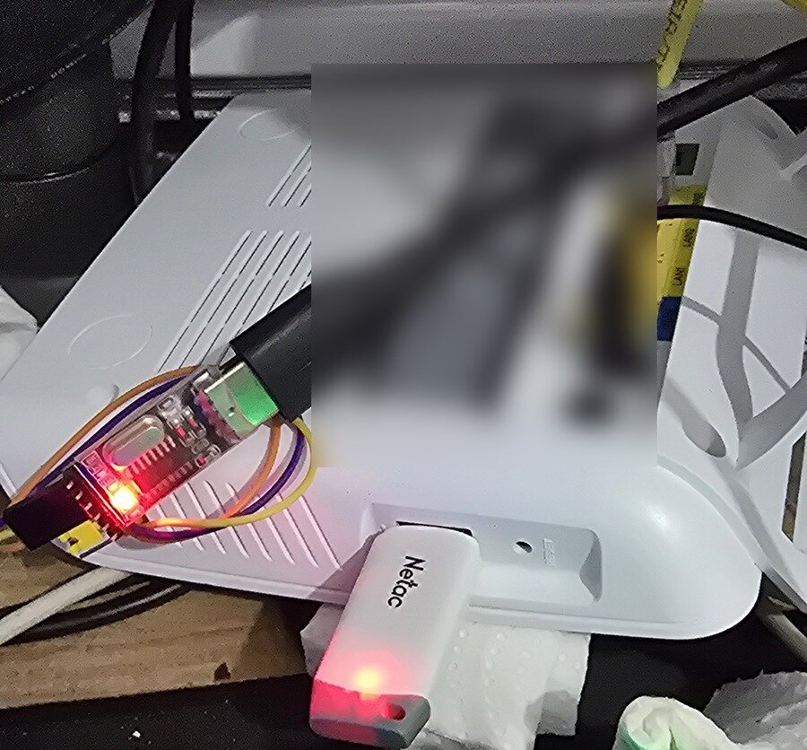

# Installation guide: OpenWrt on the Zyxel EX3501-T0

> Türkçe: [KURULUM.md](KURULUM.md)

Steps:

1. Serial console (UART)
2. Run OpenWrt from RAM only (nothing is written to flash)
3. **Full flash backup.** Do not skip this.
4. Write OpenWrt to flash
5. Going back to stock

**Risks:** opening the case voids the warranty, and 5 V on the serial pins
can damage the board. The stock firmware stays in bank 1 and you can always
return to it, but you follow this guide at your own risk.

## You need

- A **3.3 V USB-TTL serial adapter** (CH340, CP2102, FT232...). Set it to
  3.3 V if it has a jumper.
- 3 jumper wires (TX, RX, GND). If the board has no header pins: a soldering
  iron, thin solder and a 3-pin header.
- An Ethernet cable and a computer (Linux commands below).
- A TFTP server (`tftp-server`, `tftpd-hpa` or `dnsmasq`) and a serial
  terminal (`picocom`, `minicom`, `screen`, PuTTY).
- At least 300 MB free disk space for the backup.

## 1. Serial console

The board has a 3.3 V UART, **115200 8N1**.



| Adapter | Board |
|---|---|
| GND | GND |
| RX | TX |
| TX | RX |
| VCC / 3.3 V | **do not connect** |

> **Missing:** photos of the opened board showing the UART pads and the
> soldering steps are not added yet. Until then, find the pins with a
> multimeter:
> - **GND:** continuity to the shield.
> - **TX:** fluctuates around 3.3 V during boot.
> - **RX:** steady ~3.3 V.

```sh
picocom -b 115200 /dev/ttyUSB0
```

Power on: you should see U-Boot and the stock boot log. If nothing appears,
swap TX and RX.

## 2. Boot OpenWrt from RAM

Nothing is written to flash in this step; a power cycle returns to stock.

1. Connect the computer to the **WAN** port (blue mark) and give it the
   static address `192.168.1.4/24`. The vendor U-Boot uses `192.168.1.1` with
   TFTP server `192.168.1.4`. On our unit U-Boot TFTP worked on the WAN port;
   the LAN ports were not tried.

   

2. Copy `openwrt-airoha-en7523-zyxel_ex3501-t0-initramfs-kernel.bin` into the
   TFTP root (e.g. `/var/lib/tftpboot/`).
3. Power on and stop U-Boot. The Zyxel U-Boot stops on a key sequence typed
   on the serial console during the first seconds; the prompt becomes `ECNT>`.
4. At the prompt:

   ```
   tftpboot 0x81800000 openwrt-airoha-en7523-zyxel_ex3501-t0-initramfs-kernel.bin
   bootm 0x81800000
   ```

5. OpenWrt boots (~1 min). Move the cable to **LAN1–LAN3** (WAN is the
   internet side in OpenWrt) and connect: `ssh root@192.168.1.1` (no password
   in the RAM system).

## 3. Full backup (do not skip)

On the computer, in a new directory:

```sh
ssh root@192.168.1.1 cat /proc/mtd > mtd-partitions.txt
for i in 0 1 2 3 4 5 6; do
    ssh root@192.168.1.1 "cat /dev/mtd$i" > mtd$i.bin
done
sha256sum mtd*.bin > SHA256SUMS
ls -l mtd*.bin
```

Each file size must match the `size` column (hex) of `mtd-partitions.txt`;
together they are 256 MiB.

| File | Partition | Content |
|---|---|---|
| mtd0.bin | u-boot | bootloader |
| mtd1.bin | u-boot-env | U-Boot environment |
| mtd2.bin | reserved | |
| mtd3.bin + mtd4.bin | kernel + ubi | **original bank 0** (overwritten by the install) |
| mtd5.bin | firmware-stock | stock firmware, bank 1 (not touched) |
| mtd6.bin | romfile | stock config and per-device data |

- **Never share the backup:** `romfile` and `u-boot-env` contain your MAC
  address, WiFi key and ISP settings.
- Keep two copies.
- **Coverage:** the chip is 512 MiB; the defined partitions cover the first
  256 MiB. The U-Boot area in the upper half (bank flag, bad-block table) is
  not in this backup; the install only changes the bank flag there.

## 4. Write OpenWrt to flash

From the RAM system:

```sh
cat openwrt-airoha-en7523-zyxel_ex3501-t0-squashfs-sysupgrade.bin | \
    ssh root@192.168.1.1 'cat > /tmp/fw.bin'
ssh root@192.168.1.1 'sysupgrade -T /tmp/fw.bin && sysupgrade -n /tmp/fw.bin'
```

This writes the kernel and creates the UBI volumes in bank 0; bank 1 is not
touched. Then select bank 0 in U-Boot (stop it again after the reboot):

```
bootflag read
bootflag swap
bootflag read
reset
```

Repeat `swap` until `bootflag read` shows `0`. OpenWrt then boots on its own:
`192.168.1.1`, LuCI at `http://192.168.1.1`. Set a root password first
(`passwd`).

## 5. Back to stock

- `bootflag swap` in U-Boot (flag `1`) + `reset`. Stock is untouched in bank 1.
- To also restore the original bank 0 (rarely needed): RAM-boot OpenWrt as in
  step 2, copy `mtd3.bin`/`mtd4.bin` to `/tmp` and run
  `mtd write /tmp/mtd3.bin kernel; mtd write /tmp/mtd4.bin ubi`.

## After installing

- Update with a new image + `sysupgrade` (settings are kept).
- **Never use `apk upgrade` or `apk add --force-...`** on this image.
- If something breaks: [rescue mode](../README.md#rescue-mode-kurtar).
