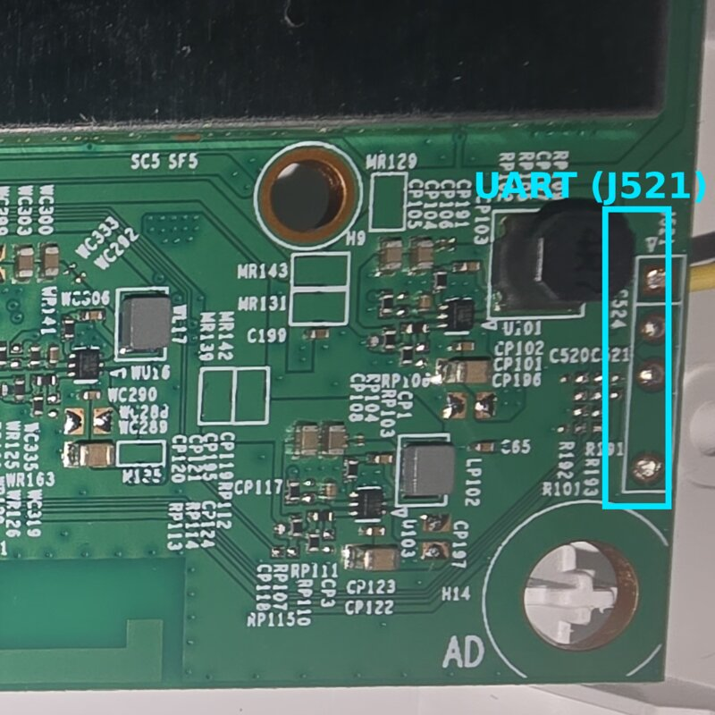
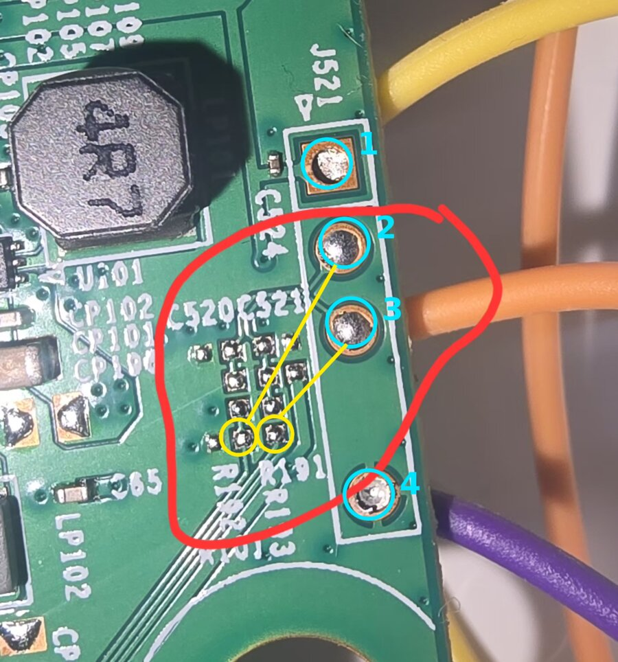
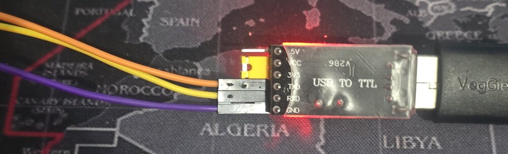
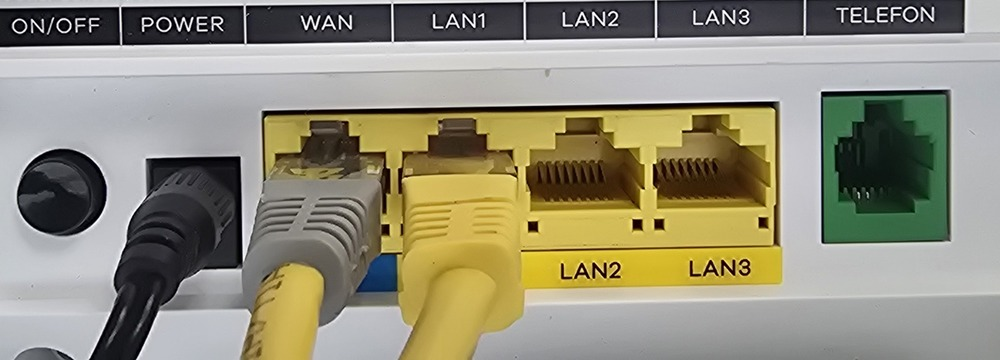

# Kurulum rehberi: Zyxel EX3501-T0'a OpenWrt

> English version: [INSTALL.md](INSTALL.md)

Bu rehber modeme OpenWrt'yi ilk kez yüklemeyi anlatır. Sırasıyla:

1. Seri konsol (UART) bağlantısı
2. OpenWrt'yi sadece RAM'de çalıştırmak (flash'a hiçbir şey yazılmaz)
3. **Flash'ın tam yedeği.** Bu adımı atlamayın.
4. OpenWrt'yi flash'a yazmak
5. Stok yazılıma geri dönmek

**Riskler:** Kutuyu açmak garantiyi bitirir. Yanlış voltaj (5 V) seri portu
yakabilir. Stok yazılım ikinci bankta (bank 1) yedek olarak kalır ve geri
dönüş her zaman mümkündür, ama bu rehberi uygulamak tamamen sizin
sorumluluğunuzdadır.

## Gerekenler

- **3,3 V USB-TTL seri adaptörü** (CH340, CP2102, FT232...). Mutlaka **3,3 V**
  olmalı; adaptörde 5 V/3,3 V seçimi varsa 3,3 V'a alın.
- 3 adet jumper kablo (TX, RX, GND). Kartta pin yoksa havya, ince lehim ve
  3 adet pin header.
- Ethernet kablosu, Linux bilgisayar (Windows'ta da olur, komutlar farklı).
- Bilgisayarda bir TFTP sunucusu (`tftp-server`, `tftpd-hpa` ya da `dnsmasq`)
  ve seri terminal (`picocom`, `minicom`, `screen` ya da PuTTY).
- Yedek için flash'ta ~260 MB, bilgisayarda en az 300 MB boş yer.

## 1. Seri konsol (UART) bağlantısı

Kartta 3,3 V seri port var, ayarları **115200 8N1**.

**Konum:** UART konnektörü **J521**, kartın sağ alt köşesinde, "AD" yazısının ve
vida deliğinin hemen üstünde, büyük "4R7" bobininin sağında.



**Önemli:** J521'in 2. ve 3. pini konnektöre **bağlı değildir**. Aradaki seri
dirençler (**R192**, **R191**) fabrikada takılmamış. Konnektöre pin takıp bağlanırsanız
hiçbir şey göremezsiniz. TX/RX kablolarını doğrudan bu boş direnç yerlerinin
pedlerine (resimde sarı halkalar) lehimleyin. Ya da R191/R192 yerine 0 Ω direnç
veya ince bir tel köprüsü koyup konnektörü kullanın.



Bu cihazda çalışan bağlantı:

| Kart | İşlev | Kablo (örnek) | USB-TTL adaptörü |
|---|---|---|---|
| J521 pin 4 | GND | mor | GND |
| R191 pedi (pin 3 tarafı) | modemin RX'i | turuncu | TXD |
| R192 pedi (pin 2 tarafı) | modemin TX'i | sarı | RXD |
| J521 pin 1 (▷ kare ped) | | **bağlamayın** | |
| | | | 5V / VCC / 3V3: **bağlamayın** |



Lehim ipuçları:
- Pedler çok küçük (SMD direnç yeri). İnce uçlu havya, flux ve ince (≤0,5 mm)
  tel kullanın. Kabloyu karta bantla sabitleyin ki çekilince ped kopmasın.
- Lehimden sonra multimetreyle komşu pedlerle kısa devre olmadığını kontrol edin.
- Emin değilseniz önce ölçün: **GND** vida deliğinin bakır halkasıyla süreklilik
  verir. Modemin **TX**'i açılış sırasında dalgalanır, **RX**'i sabit ~3,3 V durur.

Terminali açın (adaptör genelde `/dev/ttyUSB0` olur):

```sh
picocom -b 115200 /dev/ttyUSB0
```

Modemi açınca U-Boot ve stok yazılımın açılış mesajları akmalı. Hiçbir şey
gelmiyorsa TX/RX'i yer değiştirin. Bozuk karakterler geliyorsa hızı kontrol
edin.

## 2. OpenWrt'yi RAM'de çalıştırmak

Bu adımda flash'a **hiçbir şey yazılmaz**; modemi kapatıp açmak stok
yazılıma döndürür.

1. Bilgisayarı modemin **WAN** portuna (mavi şeritli) bağlayın ve kablolu
   bağlantıya sabit IP verin: `192.168.1.4/24`. Modemin U-Boot'u kendini
   `192.168.1.1`, TFTP sunucusunu `192.168.1.4` olarak bilir. Bizim kurulumda
   U-Boot TFTP'si WAN portundan çalıştı; LAN portları denenmedi.

   

2. `openwrt-airoha-en7523-zyxel_ex3501-t0-initramfs-kernel.bin` dosyasını
   TFTP sunucusunun klasörüne kopyalayın (örn. `/var/lib/tftpboot/`).
3. Modemi açın ve U-Boot'u durdurun. Zyxel'in U-Boot'u açılışın ilk
   saniyelerinde, seri konsoldan girilen bir tuş dizisiyle durur. Durunca
   istem `ECNT>` olur.
4. U-Boot'a yazın:

   ```
   tftpboot 0x81800000 openwrt-airoha-en7523-zyxel_ex3501-t0-initramfs-kernel.bin
   bootm 0x81800000
   ```

5. OpenWrt açılır (~1 dk). Kabloyu **LAN1–LAN3** portlarından birine takın
   (OpenWrt'de WAN portu internet içindir, oradan yönetim yapılmaz) ve
   bilgisayardan bağlanın:

   ```sh
   ssh root@192.168.1.1
   ```

   RAM sisteminde root şifresi yoktur.

## 3. Tam yedek (bu adımı atlamayın)

Flash'a yazmadan önce bütün bölümleri bilgisayara kopyalayın. Yedekte
kurulum sırasında üzerine yazılacak **orijinal bank 0**, U-Boot, U-Boot
ayarları, stok yazılım (bank 1) ve cihaza özel veriler (`romfile`) bulunur.

Bilgisayarda, yeni bir klasörde çalıştırın:

```sh
ssh root@192.168.1.1 cat /proc/mtd > mtd-bolumleri.txt
cat mtd-bolumleri.txt
for i in 0 1 2 3 4 5 6; do
    ssh root@192.168.1.1 "cat /dev/mtd$i" > mtd$i.bin
done
sha256sum mtd*.bin > SHA256SUMS
ls -l mtd*.bin
```

**Kontrol:** Her dosyanın boyutu `mtd-bolumleri.txt`'deki `size` değeriyle
(onaltılık) birebir aynı olmalı. Toplamları 256 MB'dir.

| Dosya | Bölüm | İçerik |
|---|---|---|
| mtd0.bin | u-boot | önyükleyici |
| mtd1.bin | u-boot-env | U-Boot ayarları |
| mtd2.bin | reserved | |
| mtd3.bin + mtd4.bin | kernel + ubi | **orijinal bank 0** (kurulumda silinir) |
| mtd5.bin | firmware-stock | stok yazılım, bank 1 (kurulumda dokunulmaz) |
| mtd6.bin | romfile | stok ayarlar ve cihaza özel veriler |

- **Yedeği kimseyle paylaşmayın.** `romfile` ve `u-boot-env` içinde cihazınızın
  MAC adresi, WiFi şifresi ve ISP ayarları bulunur.
- **Yedeği en az iki yerde saklayın** (bilgisayar + USB bellek ya da bulut).
- **Kapsam sınırı:** Flash çipi 512 MB'dir. OpenWrt'nin tanımladığı bölümler
  ilk 256 MB'yi kapsar; üst yarıdaki U-Boot'a ait alan (bank seçimi bayrağı,
  bozuk blok tablosu) bu yedekte yoktur. Kurulum o alanda sadece bank
  bayrağını değiştirir.

## 4. OpenWrt'yi flash'a yazmak

Hâlâ RAM'deki OpenWrt'deyken:

```sh
# bilgisayardan modeme kopyala (scp yok, ssh + cat kullanın)
cat openwrt-airoha-en7523-zyxel_ex3501-t0-squashfs-sysupgrade.bin | \
    ssh root@192.168.1.1 'cat > /tmp/fw.bin'
ssh root@192.168.1.1 'sysupgrade -T /tmp/fw.bin && sysupgrade -n /tmp/fw.bin'
```

Bu işlem bank 0'a çekirdeği yazar ve UBI dosya sistemini oluşturur. Bank 1'e
(stok) dokunmaz. Modem yeniden başlar.

Sonra U-Boot'a bank 0'dan açılmasını söyleyin. Modemi yeniden başlatıp
U-Boot'u durdurun ve yazın:

```
bootflag read
bootflag swap
bootflag read
reset
```

`bootflag read` `0` gösterene kadar `swap` yapın. Modem artık OpenWrt ile
açılır: `192.168.1.1`, LuCI web arayüzü `http://192.168.1.1`.

**İlk iş:** root şifresi koyun (`passwd`) ve WiFi'yi kurun.

## 4b. WiFi kalibrasyonu (önerilir)

İmaj, MediaTek'in genel `mt7916_eeprom.bin` dosyasıyla gelir; WiFi bununla
çalışır. Zyxel'in bu karta özel kalibrasyon dosyası (`RT30xxEEPROM.bin`)
telif hakkı nedeniyle imajda yoktur, ama 3. adımda aldığınız yedekte
(`mtd5.bin`, stok yazılım) duruyor. Tek komutla çıkarıp modeme kurun:

```sh
sudo dnf install squashfs-tools     # Debian/Ubuntu: sudo apt install squashfs-tools
sh tools/extract-eeprom.sh mtd5.bin 192.168.1.1
ssh root@192.168.1.1 reboot
```

Betik dosyayı bulur, boyutunu (4096 bayt) ve MT7916 imzasını kontrol eder,
modemde `/lib/firmware/mediatek/` altına koyar ve `sysupgrade`'de
korunması için `/etc/sysupgrade.conf`'a ekler.

## 5. Stok yazılıma geri dönmek

- **Kolay yol:** U-Boot'ta `bootflag swap` (bayrak `1` olsun) + `reset`. Stok
  yazılım bank 1'de olduğu gibi duruyor.
- **Orijinal bank 0'ı da geri koymak** (genelde gerekmez): 2. adımdaki gibi
  RAM'de OpenWrt açın, `mtd3.bin` ve `mtd4.bin`'i modeme kopyalayıp yazın:

  ```sh
  mtd write /tmp/mtd3.bin kernel
  mtd write /tmp/mtd4.bin ubi
  ```

## Kurulumdan sonra

- Güncelleme: yeni imaj + `sysupgrade` (ayarlar korunur).
- **`apk upgrade` ve `apk add --force-...` kullanmayın.** Bu imajın çekirdeği
  ve sürücüleri özel derlemedir; resmi depodan paket karıştırmak WiFi'yi,
  güvenlik duvarını ve PPPoE'yi silebilir. İmajdaki apk koruması bunu reddeder.
- Bir şey bozulursa: [kurtarma modu](../README.md#rescue-mode-kurtar)
  (`kurtar`).
